# P8 visual evidence

This dedicated branch contains review images, not application source.
The refreshed candidate images correspond to application commit
`623c5a4906575dad027a77acaf5fc641a21e2c26` (PR #59). Anonymous P7 before images
are unchanged.

- `before/`: the existing P7 production site at `https://skillar.sh/dashboard/`,
  captured anonymously before the P8 deployment.
- `after/`: the P8 candidate build's anonymous dashboard, at the same viewport
  and color theme, served by the loopback QA harness.
- `fixture/`: the candidate's authenticated views and consent controls. Every
  activity record and account shown comes from the repository's synthetic
  in-memory fixtures. No owner's local data, browser session, or credentials
  are included.

The candidate images establish UI behavior, not production activation. The PR
records deployment and post-deployment verification separately.

Phone captures use 390 CSS pixels, DPR 3 and touch emulation (1170 x 2532 PNG).
Desktop captures use 1440 x 900 CSS pixels at DPR 1. Originals are preserved.
The complete private QA packet covers 234 states across 390, 1440 and 1920 CSS
pixels, in light and dark themes.

## Anonymous before and after

| View | Before production | After candidate |
| --- | --- | --- |
| Phone, light | 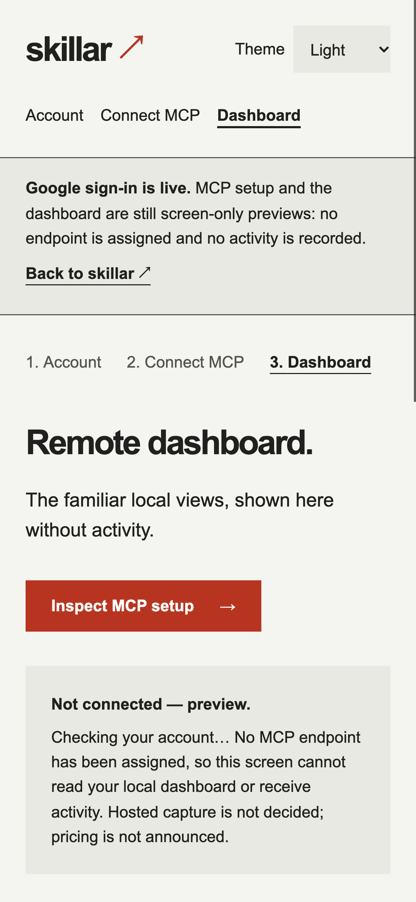 | 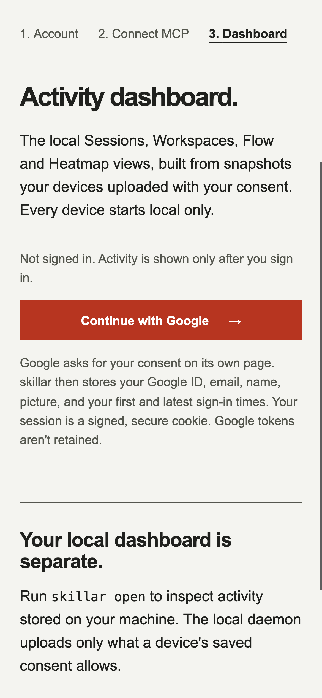 |
| Phone, dark | 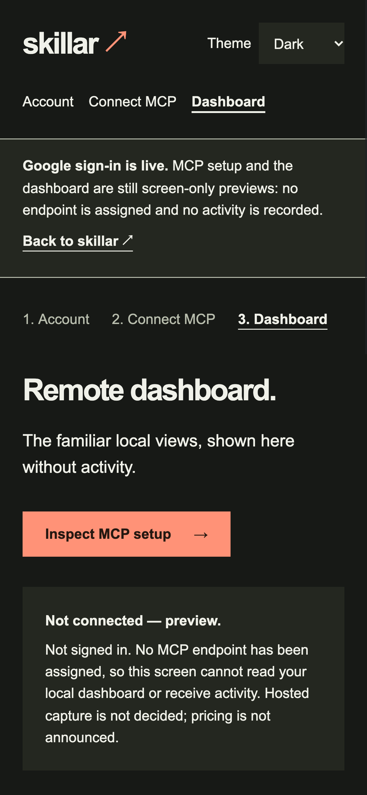 | 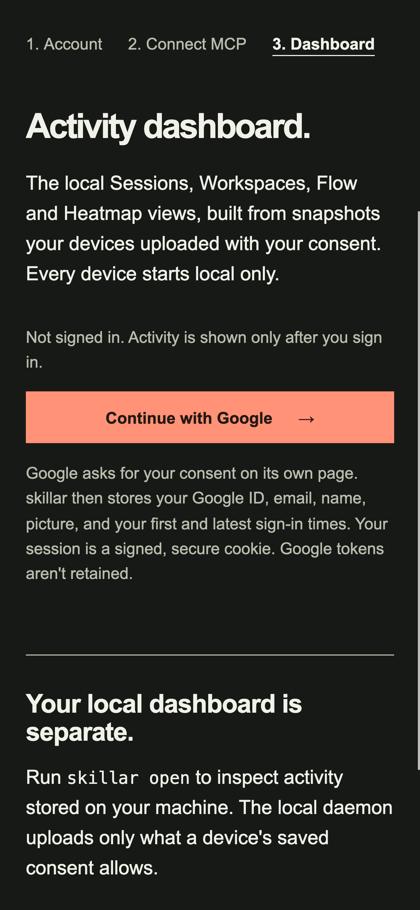 |
| Desktop, light | 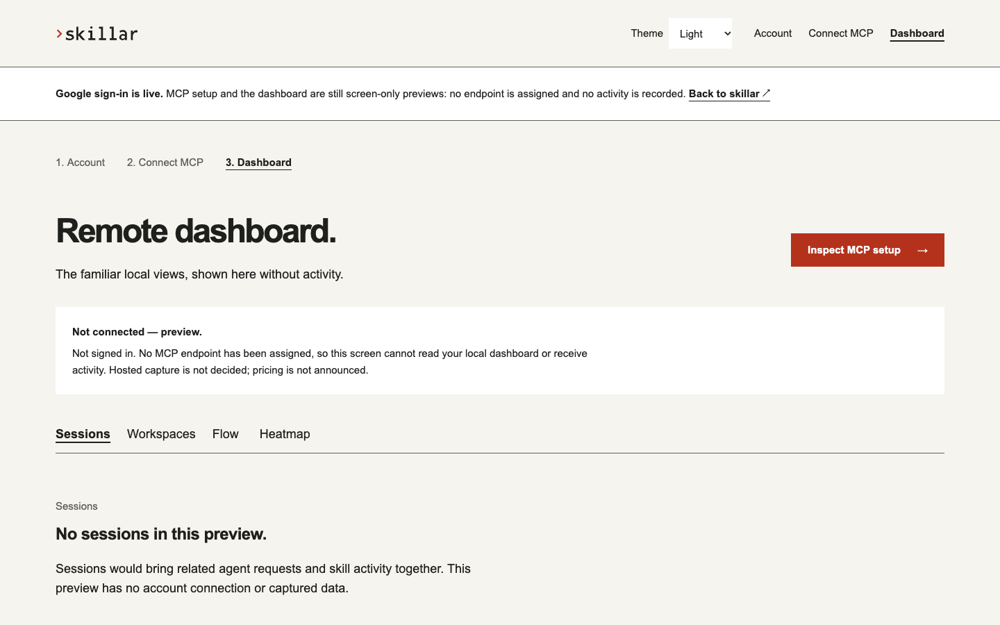 | 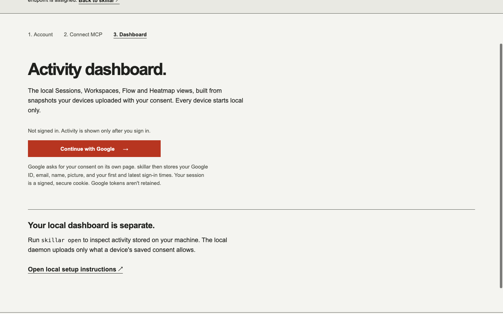 |
| Desktop, dark | 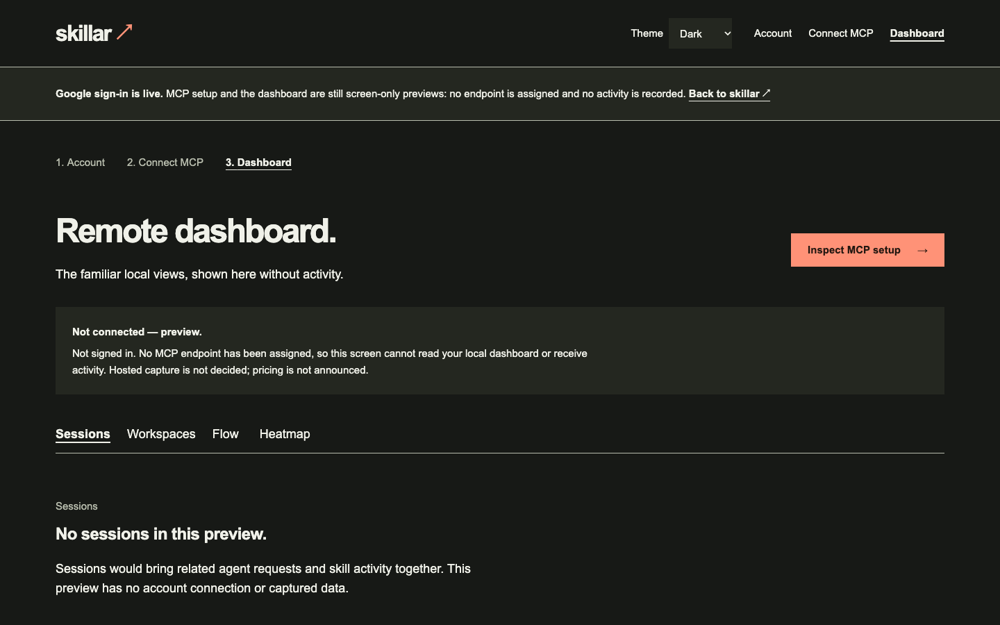 | 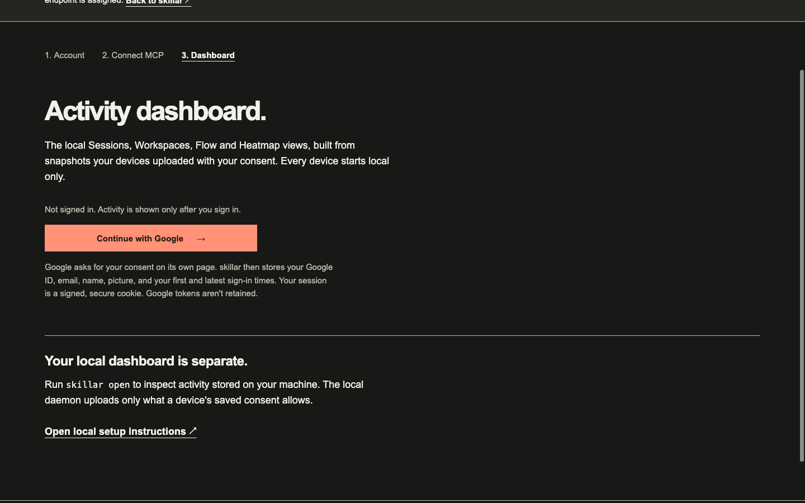 |

## Synthetic authenticated fixtures

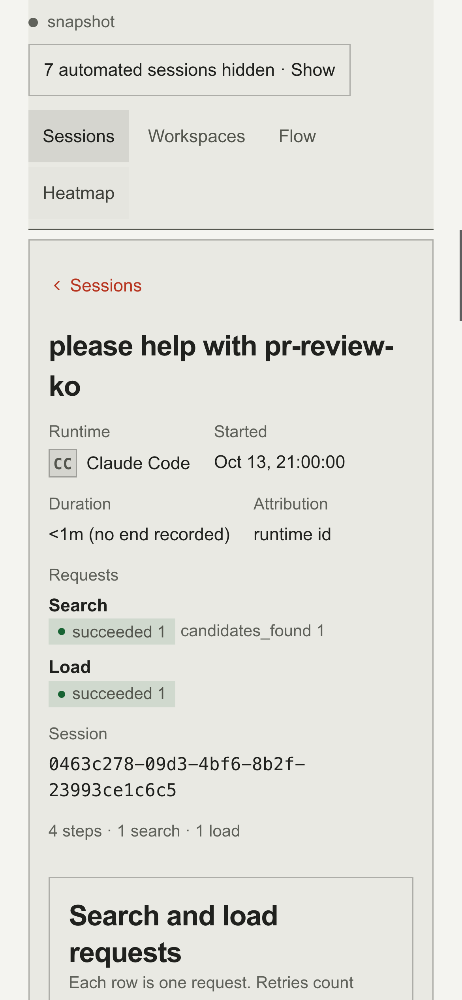

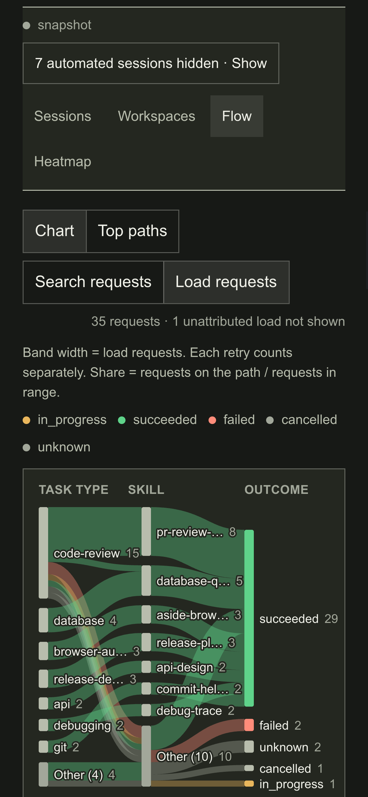

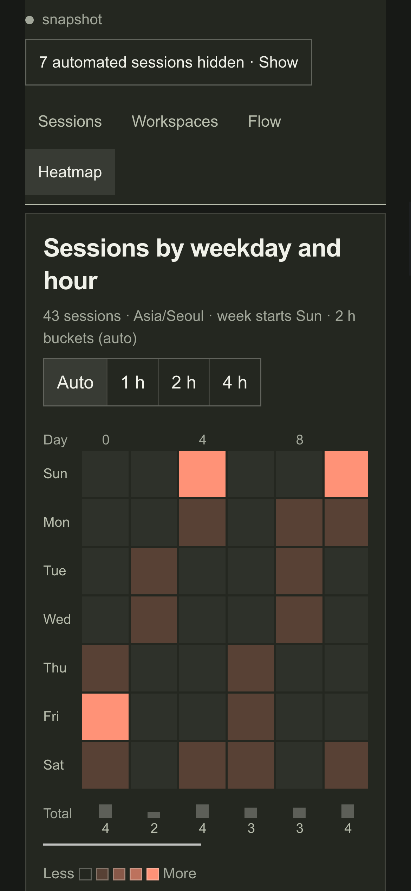

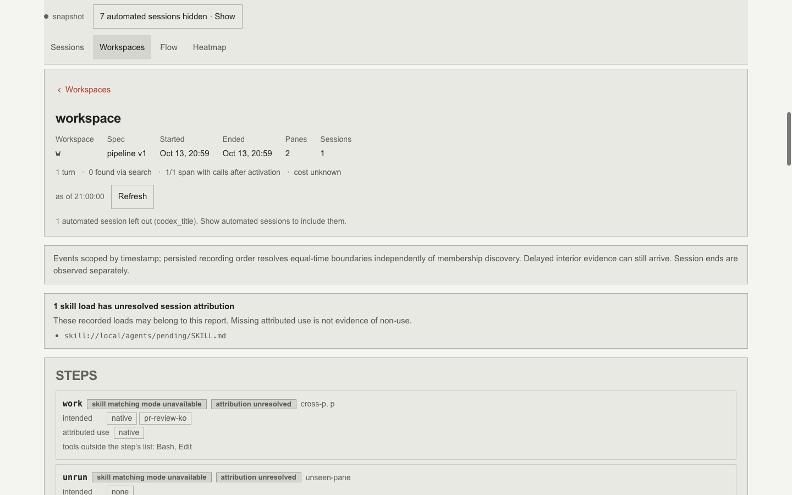

Selecting managed content for a new device still leaves every content category
unchecked until the user explicitly chooses it:

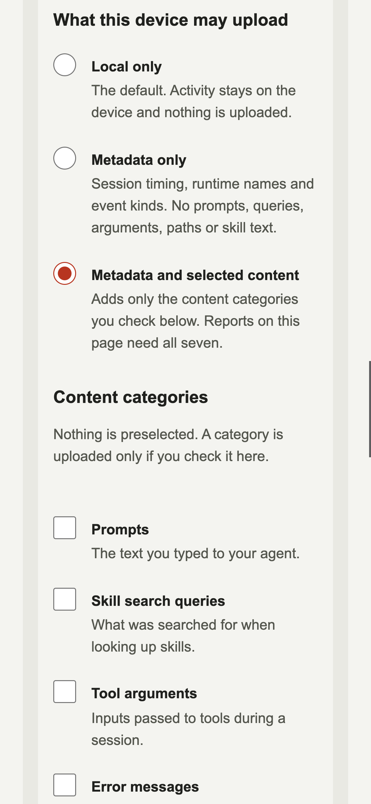
